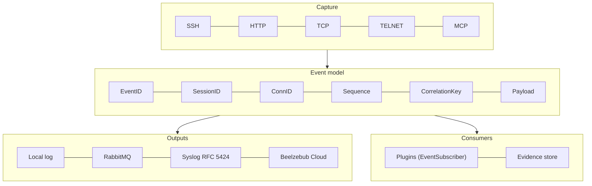

# Beelzebub

**Open-source deception framework.**

Deploy realistic decoys. Observe attacker behavior. Turn interactions into security evidence.

**[Explore Beelzebub Platform](https://beelzebub.ai/products/beelzebub-cloud/)** · [Documentation](https://docs.beelzebub.ai) · [Quick start](#get-started) · [中文版](README.zh-CN.md)

[](https://github.com/beelzebub-labs/beelzebub/actions/workflows/main.yml)
[](https://codecov.io/gh/beelzebub-labs/beelzebub)
[](LICENSE)
[](https://pkg.go.dev/github.com/beelzebub-labs/beelzebub/v3)
[](https://github.com/avelino/awesome-go)

Beelzebub gives security teams a configurable way to study activity directed at decoy services. Define the environment an attacker encounters, choose how it responds, and capture the interaction for investigation. Run the framework independently or connect it to Beelzebub Platform.

## Why Beelzebub

- **Deploy decoys that fit your environment.** Define services, routes, and response rules in YAML. Use static handlers for predictable behavior or LLM-powered responses for adaptive interactions. Extend the runtime with trusted Go plugins when you need custom behavior.
- **Observe what happens after contact.** Capture evidence from decoy interactions, including commands, HTTP request details, and session context, depending on the protocol. Give analysts a record of activity directed at the service to support investigation.
- **Bring evidence into your workflow.** Inspect logs locally, publish structured events to RabbitMQ, or enable Beelzebub Platform reporting. Enable Prometheus metrics with `core.prometheus.enabled: true` to monitor runtime activity; by default, the metrics listener is disabled and binds no port.

## See it in action

Watch an LLM-powered decoy respond to attacker input. The demo illustrates how generated responses can sustain an interaction beyond a fixed set of command handlers.


## How it works

[](docs/public/readme/how-it-works.svg)

Define services and rules in YAML, validate the configuration, and start the runtime. Trusted Go plugins are compiled into the runtime to extend services and responses. Each service handles incoming interactions and emits evidence through the configured event output. LLM responses require a configured provider; static handlers can run without one.

The framework supports **SSH, HTTP, TCP, TELNET, and MCP**. MCP decoys expose bait tools that make suspicious invocations observable during controlled agent testing. They can provide evidence of prompt-injection attempts; they do not guarantee detection of every attempt.

Deployment options include a local Go binary, Docker Compose, and Kubernetes with Helm. See the [architecture guide](https://docs.beelzebub.ai/concepts/architecture) for runtime behavior and extension boundaries.

## Explore the decoys

Start with one of the **18 example configurations** in [configurations/services](configurations/services). Open a YAML file to inspect its rules and adapt it to your environment.

| Category | Example decoys |
| --- | --- |
| Remote access | [SSH](configurations/services/ssh-22.yaml) · [SSH (LLM)](configurations/services/ssh-2222.yaml) · [TELNET](configurations/services/telnet-23.yaml) · [RDP](configurations/services/tcp-3389-rdp.yaml) · [VNC](configurations/services/tcp-5900-vnc.yaml) |
| Web | [WordPress (LLM fallback)](configurations/services/http-80.yaml) · [HTTP 401](configurations/services/http-8080.yaml) · [HTTP methods](configurations/services/http-methods-8081.yaml) · [Apache directory maze](configurations/services/http-maze-8888.yaml) |
| Databases & caches | [MySQL](configurations/services/tcp-3306.yaml) · [PostgreSQL (LLM)](configurations/services/tcp-5432-postgresql-llm.yaml) · [SQL Server](configurations/services/tcp-1433-mssql.yaml) · [Redis](configurations/services/tcp-6379-redis.yaml) · [Memcached](configurations/services/tcp-11211-memcached.yaml) |
| Network services | [SMB](configurations/services/tcp-445-smb.yaml) · [LDAP](configurations/services/tcp-389-ldap.yaml) |
| IoT | [MQTT](configurations/services/tcp-1883-mqtt.yaml) |
| AI agents | [MCP bait tools](configurations/services/mcp-8000.yaml) |

Examples range from banners and selected responses to interactive exchanges. **LLM** examples require a configured provider; WordPress uses it for its catch-all route. Check your deployment's port mappings when enabling additional examples.

## Capability map

The runtime is organised in four layers. Each one extends without touching the others: a new decoy does not require a new event model, and a new output does not require a new decoy.



| Layer | What it covers | Extension point |
| --- | --- | --- |
| **Capture** | SSH, HTTP, TCP, TELNET and MCP decoys. Raw frames, request bodies, credentials, session lifecycle | YAML services, Go plugins |
| **Event model** | One canonical record per interaction. `ID` keeps its historical per-protocol meaning; `EventID`, `SessionID`, `ConnID`, `Sequence`, `CorrelationKey` and `Payload` are additive | `pkg/plugin.Event` |
| **Outputs** | Local log, RabbitMQ, syslog and the Beelzebub Cloud. They are composed, not exclusive: enabling a second one no longer replaces the first | `core.tracings` |
| **Consumers** | Plugins that observe every event, and the evidence store that archives the payloads | `plugin.EventSubscriber`, `core.evidence` |

### What the event model buys you

| Question | Answered with |
| --- | --- |
| Which host is this? | `CorrelationKey` — protocol, service and source, stable across connections |
| Which interaction is this? | `SessionID` — the connection for TCP, SSH and TELNET, a rolling session per source for HTTP and MCP |
| In which order? | `Sequence` — monotonic within a session. The events are dispatched concurrently, their arrival order is not guaranteed |
| Which single record is this? | `EventID` — unique across the runtime |
| What were the exact bytes? | `Payload` — the raw frame, for the protocols that can provide it |
| Was this an AI agent? | `Metadata` — `llm_injection`, `llm_refusal_replaced`, `llm_guardrail`, `llm_truncated`, `llm_credentials_redacted` |

### Guardrails and isolation

| Surface | Control |
| --- | --- |
| Prompt jailbreak | The attacker content is fenced and declared as data, the guardrail verdict is matched by containment, and a refusal is replaced by an in-character answer |
| Credential exfiltration | The credential shapes found in the attacker content are masked before it leaves the perimeter |
| Path traversal | The decoy content is generated, never read from disk. The samples are named after their SHA-256: the attacker never influences a path |
| Fingerprinting | The paths an administrator reads first — `/etc/passwd`, `/etc/shadow`, `/root/.bash_history` — are answered with a plausible **synthetic** file, not a directory listing. The real file of the host is never disclosed |
| Container escape | The [hardened profile](docker-compose.hardened.yml) drops every capability, forbids the privilege escalation, mounts a read-only root filesystem and caps the resources. The egress allowlist lives on the host firewall |
| Evidence integrity | The events carry a hash chain friendly identity, the payload is copied per consumer, and the logs are created with `0600` |

## Verification

```bash
make build            # build the runtime
make test.unit        # unit tests
make adversarial      # path traversal, container escape and prompt jailbreak suite
make validate-all     # service configuration schemas and validation
go test -race ./...   # concurrency
```

| Check | Result |
| --- | --- |
| `make build` | OK |
| `go vet ./...` | OK |
| `gofmt -l .` | clean |
| `make test.unit` | 21 packages, 1019 cases, all green |
| `go test -race ./...` | clean, no data race |
| `make validate-all` | 0 errors, 6 warnings (all pre-existing upstream) |
| `make adversarial` | 87 cases in 19 groups, all green |

The adversarial suite covers the three attacks that matter for a decoy:

| Group | Asserts |
| --- | --- |
| Path traversal | The decoy answers a traversal attempt with generated content, never with a file of the host. The sample store stays inside its root whatever name the attacker suggests |
| Container escape | The hardened profile keeps its user, its capability drop, its read-only filesystem, its resource ceilings and its read-only configuration. The live escape attempts live in `scripts/verify-sandbox.sh` and need a container runtime |
| Prompt jailbreak | The attacker content reaches the model fenced and never in an instruction position, the guardrail is not bypassed by a wording, a refusal is replaced, the credentials do not leave the perimeter, and the findings reach the event metadata |
| System files | The thirteen paths an administrator reads first are answered with a file and not with a listing, the passwd entries are well formed, the shadow passwords are all locked, the answer is never the file of the host, and the same path always answers the same content |

Two end-to-end runs back the capture path:

```text
# The syslog pipeline
<157>1 2026-11-12T10:10:53Z host honeypot 94174 http [beelzebub@32473 src="127.0.0.1" proto="HTTP" session="95102c3d-..." correlation="HTTP|:8080|127.0.0.1" eventid="f254be66-..."] {"DateTime":"...","Protocol":"HTTP",...}

# The evidence store: the sample is byte identical to what was posted
samples/ac/ac7cfbc2a2402a7539d8655542e10eec932ac8a3c4396f35e2025352331055cf.bin
```

## Get started

You need **Git, a shell, and Docker Engine with Compose v2**. Use an **isolated lab host** with authorization for all configured listeners: the installer starts a bundle of example services, including privileged ports. On Linux it can enable **host networking**; Docker does not provide network isolation in that mode.

Use synthetic credentials and review the [production safety guide](https://docs.beelzebub.ai/operations/production-safety) before exposing services to the internet.

```bash
git clone https://github.com/beelzebub-labs/beelzebub.git
cd beelzebub
./install.sh --docker
```

Platform reporting is optional. Leave the Platform token blank when prompted to run independently. The runtime validates its configuration before starting listeners.

Test the default HTTP decoy and inspect its logs:

```bash
curl -i http://localhost:8080/
docker compose logs -f beelzebub
```

Expect **`401 Unauthorized`** from the bundled HTTP example on port 8080. This is the decoy's configured response, confirming that the listener is reachable. If the installer skipped an occupied port, resolve the conflict before testing. Press `Ctrl+C` to stop following logs.

Stop the lab when finished:

```bash
docker compose down
```

For a single-service setup or another deployment method, follow the [installation guide](https://docs.beelzebub.ai/getting-started/installation).

## Beelzebub Platform

The open-source framework is the foundation: deploy, operate, and extend it independently. **Beelzebub Platform** is the managed product for teams that need to coordinate deception across environments and connect runtime evidence to a broader security workflow.

Explore the platform's deployment, investigation, and reporting capabilities, and see how they fit your team's requirements.

**[Explore Beelzebub Platform →](https://beelzebub.ai/products/beelzebub-cloud/)**

## Resources and community

- **[中文文档](README.zh-CN.md):** the capability map, the verification results and the deployment guidance, in Chinese.
- **[Documentation](https://docs.beelzebub.ai):** configuration, protocols, operations, integrations, and recipes.
- **[Plugin authoring](https://docs.beelzebub.ai/plugins/authoring):** build extensions with the public Go SDK. Plugins execute in-process; review their source and pin trusted versions.
- **[Isolation](docs/content/docs/operations/isolation.mdx):** the two sandboxes, the threat matrix and the egress rules for an exposed deployment.
- **[Syslog pipeline](docs/content/docs/operations/syslog.mdx):** ship the runtime events to a central log server over RFC 5424.
- **[Contributing](CONTRIBUTING.md):** contribute code, examples, or documentation under the [Code of Conduct](CODE_OF_CONDUCT.md). Report vulnerabilities privately through [SECURITY.md](SECURITY.md).

For development, use the Go version declared in [go.mod](go.mod), Git, and Make. Build with `make build`; run `make test.unit`, `make adversarial`, `go vet ./...`, and `make validate-all` before submitting runtime changes. The [development workflow](https://docs.beelzebub.ai/contributing/development) covers integration tests and their Docker dependencies.

Thank you to [JetBrains](https://jb.gg/OpenSourceSupport) for supporting development with tools through its open-source support program.

Licensed under the [GNU General Public License v3.0](LICENSE).
