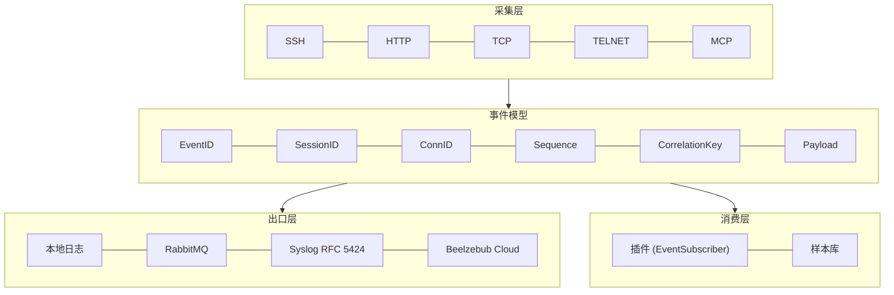

# Beelzebub

**开源欺骗框架。** 部署逼真的诱饵,观察攻击者行为,把交互变成安全证据。

**[能力地图](#能力地图)** · **[验证结果](#验证结果)** · **[快速开始](#快速开始)** · [English](README.md)

---

## 为什么是 Beelzebub

- **按你的环境部署诱饵。** 用 YAML 定义服务、路由和响应规则。静态 handler 行为可预测,LLM 驱动的响应能自适应交互,Go 插件可以在需要时扩展运行时。
- **接触之后才看清发生了什么。** 捕获诱饵交互的证据 —— 命令、HTTP 请求细节、会话上下文,按协议而定。给分析人员一份针对该服务的活动记录,支撑调查。
- **把证据接进你的工作流。** 本地日志、结构化事件投递到 RabbitMQ,或上报 Beelzebub Platform。开启 `core.prometheus.enabled: true` 可以用 Prometheus 观测运行时活动;默认关闭指标监听器,不占用任何端口。

## 能力地图

运行时分四层。每一层都可以独立扩展:加一个新诱饵不需要改事件模型,加一个新出口不需要改诱饵。



| 层 | 覆盖范围 | 扩展点 |
| --- | --- | --- |
| **采集层** | SSH、HTTP、TCP、TELNET、MCP 诱饵。原始帧、请求体、凭据、会话生命周期 | YAML 服务配置、Go 插件 |
| **事件模型** | 每次交互一条统一记录。`ID` 保留历史语义(各协议不一致),`EventID`/`SessionID`/`ConnID`/`Sequence`/`CorrelationKey`/`Payload` 为**新增字段** | `pkg/plugin.Event` |
| **出口层** | 本地日志、RabbitMQ、syslog、Beelzebub Cloud。**并行投递,互不覆盖** | `core.tracings` |
| **消费层** | 订阅全部事件的插件,以及归档攻击者投递载荷的样本库 | `plugin.EventSubscriber`、`core.evidence` |

### 事件模型能回答什么

| 问题 | 用哪个字段 |
| --- | --- |
| 这是哪台主机? | `CorrelationKey` —— 协议 + 服务 + 来源,跨连接稳定 |
| 这是哪一次交互? | `SessionID` —— TCP/SSH/TELNET 是连接,HTTP/MCP 是按来源滚动的会话 |
| 顺序是什么? | `Sequence` —— 会话内单调递增。**事件由多个 worker 并发分发,到达顺序不保证** |
| 这一条记录是哪一条? | `EventID` —— 全局唯一 |
| 原始字节是什么? | `Payload` —— 原始帧,仅在协议能无损提供时填充 |
| 这次是 AI Agent 干的吗? | `Metadata` —— `llm_injection`、`llm_refusal_replaced`、`llm_guardrail`、`llm_truncated`、`llm_credentials_redacted` |

### 护栏与隔离

| 攻击面 | 控制手段 |
| --- | --- |
| 提示词越狱 | 攻击者内容被**围栏隔离**并声明为数据;护栏判定由**精确匹配改为包含匹配**;模型拒答被替换成符合角色的回答 |
| 凭据外泄 | 攻击者内容里的凭据形态在**出网前**被掩码 |
| 目录穿越 | 诱饵内容全部**生成**,从不读磁盘。样本文件名**只由 SHA-256 派生**,攻击者无法影响任何路径 |
| 容器逃逸 | [加固 profile](docker-compose.hardened.yml):丢弃全部 capability、禁止提权、只读根文件系统、资源上限。出网白名单由**宿主机防火墙**执行 |
| 证据完整性 | 事件带可校验的身份字段;载荷逐消费者拷贝;日志权限 `0600` |
| 证据留存 | 样本按 digest 去重、原子落盘、权限 `0600`,目录 `0700` |

### 双沙盒

| | 外层沙盒 | 内层沙盒 |
| --- | --- | --- |
| 关住 | 被攻陷的进程 | 攻击者注入的内容 |
| 边界 | 容器、网络、宿主机 | 提示词、事件、样本目录 |
| 失效后果 | 攻击者横向进内网 | 运维的系统/数据被攻击者内容影响 |

详见 [隔离模型](docs/content/docs/operations/isolation.mdx)。

## 看看诱饵长什么样

从 [configurations/services](configurations/services) 的 **19 个示例配置**里挑,打开 YAML 就能改。

| 类别 | 示例诱饵 |
| --- | --- |
| 远程接入 | [SSH](configurations/services/ssh-22.yaml) · [SSH (LLM)](configurations/services/ssh-2222.yaml) · [TELNET](configurations/services/telnet-23.yaml) · [RDP](configurations/services/tcp-3389-rdp.yaml) · [VNC](configurations/services/tcp-5900-vnc.yaml) |
| Web | [WordPress (LLM fallback)](configurations/services/http-80.yaml) · [HTTP 401](configurations/services/http-8080.yaml) · [HTTP methods](configurations/services/http-methods-8081.yaml) · [Apache 目录迷宫](configurations/services/http-maze-8888.yaml) |
| 数据库与缓存 | [MySQL](configurations/services/tcp-3306.yaml) · [PostgreSQL (LLM)](configurations/services/tcp-5432-postgresql-llm.yaml) · [SQL Server](configurations/services/tcp-1433-mssql.yaml) · [Redis](configurations/services/tcp-6379-redis.yaml) · [Memcached](configurations/services/tcp-11211-memcached.yaml) |
| 网络服务 | [SMB](configurations/services/tcp-445-smb.yaml) · [LDAP](configurations/services/tcp-389-ldap.yaml) |
| IoT | [MQTT](configurations/services/tcp-1883-mqtt.yaml) |
| AI Agent | [MCP 诱饵工具](configurations/services/mcp-8000.yaml) |

示例覆盖从单一 banner 到可交互的完整会话。**LLM** 示例需要配置模型 provider;WordPress 用它兜底 catch-all 路由。开启更多示例前先确认部署的端口映射。

**系统文件也会被伪造。** 攻击者最先读的是 `/etc/passwd`、`/etc/shadow`、`/root/.bash_history` —— 蜜罐知道这些路径**是文件而不是目录**,会返回格式真实但**完全是合成内容**的假文件(shadow 里的密码全部锁定,私钥保护不了任何东西,history 里是管理员的习惯,正是引诱下一步的诱饵)。宿主机的真实文件永远不会被读出。

## 快速开始

需要 **Git、shell,以及带 Compose v2 的 Docker Engine**。用**隔离的实验机**部署,并取得所有监听端口的授权:安装脚本会启动一整套示例服务,包括特权端口。Linux 上它可以启用 **host 网络** —— Docker 在该模式下不提供网络隔离。

使用**合成凭据**,并在暴露到互联网前阅读[生产安全指南](docs/content/docs/operations/production-safety)。

```bash
git clone https://github.com/beelzebub-labs/beelzebub.git
cd beelzebub
./install.sh --docker
```

Platform 上报是可选的。提示时把 Platform token 留空即可独立运行。运行时会先校验配置,再启动监听器。

测试默认的 HTTP 诱饵并查看日志:

```bash
curl -i http://localhost:8080/
docker compose logs -f beelzebub
```

预期返回 **`401 Unauthorized`** —— 这是配置好的响应,说明监听器可达。如果安装脚本跳过了被占用的端口,先解决冲突再测试。按 `Ctrl+C` 停止跟随日志。

结束时收工:

```bash
docker compose down
```

需要单个服务或别的部署方式,看[安装指南](docs/content/docs/getting-started/installation)。

### 隔离部署

生产环境不要用默认的 compose,用加固 profile:

```bash
mkdir -p logs samples state && sudo chown -R 65534:65534 logs samples state
docker compose -f docker-compose.hardened.yml up -d --build
```

它以非 root 运行、丢弃全部 capability、挂只读根文件系统、给资源设上限,并把配置只读挂载。**出网白名单必须由宿主机防火墙配**,规则见[隔离文档](docs/content/docs/operations/isolation.mdx)。

### 日志管道

本地日志之外,事件可以推到中心日志服务器:

```yaml
core:
  tracings:
    syslog:
      enabled: true
      address: "logs.internal:514"
      protocol: "tcp"           # tcp | udp
      framing: "octet-counted"  # RFC 6587 | non-transparent
      facility: "local3"
      severity: "auto"          # auto | error | warning | ...
      app-name: "honeypot"
```

报文是 RFC 5424:事件 JSON 作为 MSG,结构化数据带 `src` / `session` / `correlation` / `eventid`。连接**懒建立、断线重连** —— 日志服务器挂了不会阻塞启动,也不会中断捕获。各出口**并行投递**,开 syslog 不会影响 RabbitMQ。

## 验证结果

```bash
make build            # 构建运行时
make test.unit        # 单元测试
make adversarial      # 目录穿越 / 容器逃逸 / 提示词越狱 对抗套件
make validate-all     # 服务配置 schema 与校验
go test -race ./...   # 并发
```

| 检查项 | 结果 |
| --- | --- |
| `make build` | OK |
| `go vet ./...` | OK |
| `gofmt -l .` | clean |
| `make test.unit` | 21 个包,1019 个用例,全绿 |
| `make adversarial` | 87 个用例 / 19 组,全绿 |
| `go test -race ./...` | 干净,无 data race |
| `make validate-all` | 0 errors,6 warnings(全部为上游既有) |

对抗套件覆盖蜜罐最该防的三类攻击:

| 分组 | 断言 |
| --- | --- |
| 目录穿越 | 8 种穿越载荷打向蜜罐,答案必须是**蜜罐自己生成的答案之一**,且**逐字节不等于**宿主文件。样本库用攻击者建议的名字投喂,检查每个文件都在 root 内、旁边的 canary 未被动 |
| 容器逃逸 | 加固 profile 必须保持:非 root、`cap_drop: ALL`、`no-new-privileges`、只读根文件系统、资源上限、配置只读、**无 docker.sock**、端口绑定显式地址。实时逃逸尝试在 `scripts/verify-sandbox.sh`,需要容器运行时 |
| 提示词越狱 | 用**假 provider** 端到端验证:攻击者内容必须被围栏且**永不进入指令位**、护栏判定不能被措辞绕过、拒答被替换、凭据不出网、findings 进事件 metadata |
| 系统文件 | 13 个系统路径必须以**文件**形式返回(不是目录列表);passwd 格式合法、shadow 密码全部锁定、内容**不等于**宿主文件、同一路径内容稳定 |

两次端到端实测支撑采集链路:

```text
# syslog 管线
<157>1 2026-11-12T10:10:53Z host honeypot 94174 http [beelzebub@32473 src="127.0.0.1" proto="HTTP" session="95102c3d-..." correlation="HTTP|:8080|127.0.0.1" eventid="f254be66-..."] {"DateTime":"...","Protocol":"HTTP",...}

# 样本库:落盘样本与投递内容逐字节一致
samples/ac/ac7cfbc2a2402a7539d8655542e10eec932ac8a3c4396f35e2025352331055cf.bin
```

## 开发

用 [go.mod](go.mod) 声明的 Go 版本、Git 和 Make。改运行时代码前跑 `make build`、`make test.unit`、`make adversarial`、`go vet ./...` 和 `make validate-all`。

- **[插件编写](docs/content/docs/plugins/authoring.mdx):** 用公共 Go SDK 扩展响应、HTTP 行为、二进制 TCP 交互。插件**在进程内执行** —— 审查源码并固定可信版本。
- **[隔离模型](docs/content/docs/operations/isolation.mdx):** 双沙盒、威胁矩阵、出网规则。
- **[syslog 管线](docs/content/docs/operations/syslog.mdx):** 把事件送到中心日志服务器。

## Beelzebub Platform

开源框架是基础:可以独立部署、运维和扩展它。**Beelzebub Platform** 是托管产品,面向需要跨环境协同欺骗、并把运行时证据接入更广安全工作流的团队。

**[了解 Beelzebub Platform →](https://beelzebub.ai/products/beelzebub-cloud/)**

## 许可

本项目基于 [GNU General Public License v3.0](LICENSE) 发布,源自 `beelzebub-labs/beelzebub`。

上游作者:Mario Candela(2022-2030)。本仓库是上游的 fork,修改部分同样以 GPL-3.0 发布。

上游项目:[beelzebub-labs/beelzebub](https://github.com/beelzebub-labs/beelzebub) · 文档 [docs.beelzebub.ai](https://docs.beelzebub.ai)
